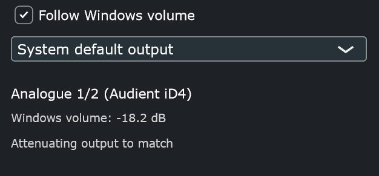

# Windows Volume Follow

**Version 0.1.0 alpha.** Expect rough edges.

A small VST3 effect that makes audio follow the **Windows system volume**, built for the case where an ASIO driver (for example the Audient iD4 in REAPER) bypasses the Windows mixer and always plays at full level.

Put it last in REAPER's **Monitoring FX** chain (or on any track or master FX chain) and it attenuates the signal to match the Windows volume slider and mute state.



## How it works

- Reads the Windows endpoint volume through the Core Audio API (`IAudioEndpointVolume`), as a dB level plus the mute flag. The dB value is what Windows actually applies; the 0-1 slider position is not linear in level.
- Updates through Windows change notifications, with a 2 s safety poll. No polling happens on the audio thread, which only reads an atomic value.
- Gain only goes down (0 dB at most), with a short smoothing ramp to avoid zipper noise.
- Follows the default output device, or a specific output device you pick in the dropdown. The choice is saved with the project or FX chain.

## Limitations

- Windows only (x64), VST3 only.
- In REAPER, Monitoring FX do not process everything. The native metronome and some previews can bypass it depending on routing.
- It attenuates only. The interface's own hardware knob still applies after it.
- On a master FX chain it also affects renders, so bypass it before rendering.

## Build

Requires CMake and Visual Studio / MSVC Build Tools. JUCE 8.0.9 is fetched automatically.

```
cmake -S . -B build -G Ninja -DCMAKE_BUILD_TYPE=Release
cmake --build build
```

Run from an MSVC developer prompt (`vcvars64.bat`). Keep the folder path short, because long paths can break MSVC. The plugin is produced in `build/WinVolumeFollow_artefacts/Release/VST3/`. Copy the `Windows Volume Follow.vst3` folder to `C:\Program Files\Common Files\VST3`, then rescan plugins.

## License

The source code in this repository is released under the **MIT License** (see `LICENSE`).

The plugin is built with [JUCE](https://juce.com), which is dual-licensed (AGPLv3 or a commercial JUCE license). MIT applies to this project's own code. A built plugin binary also contains JUCE, so distributing it must comply with JUCE's license: the release binaries here are built under JUCE's AGPLv3 option, and if you build your own copy for distribution you need to follow AGPLv3 or hold a JUCE commercial license.
